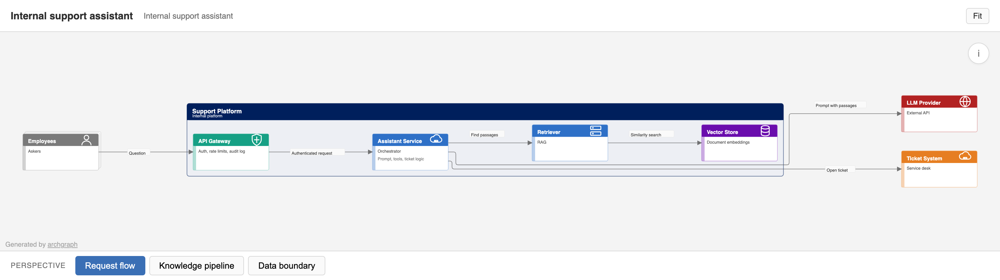
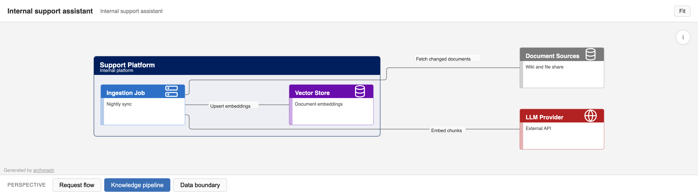

# archgraph

Render architecture diagrams from declarative YAML into a single, self-contained
HTML file with several switchable perspectives on the same model.



## The problem

One architecture rarely fits one diagram: the request path, the data pipeline
and the trust boundaries all involve the same components but answer different
questions. Drawing each view by hand means they drift apart. archgraph keeps a
single list of resources and lets each *perspective* pick the relations it
cares about; a perspective shows only the resources it uses.

The input format is a subset of the YAML used by
[Ilograph](https://www.ilograph.com/desktop/). archgraph is an independent
project and is not affiliated with Ilograph; no Ilograph code or assets are
included.

## What it does

- Parses YAML (`js-yaml`) and validates it with a Zod schema.
- Lays out each perspective with [ELK](https://github.com/kieler/elkjs)
  (layered, orthogonal edges, nested resources).
- Emits one `.html` file with inline SVG: perspective tabs, pan and zoom,
  hover highlighting of connected resources. No runtime dependencies.
- Optionally writes one PNG per perspective (`--png`, via
  `@resvg/resvg-js`, no browser needed).

The second perspective of the same example, same model, different relations:



## Data format

Resources form a tree; perspectives list relations between them by name.

```yaml
resources:
  - name: Support Platform
    subtitle: Internal platform
    color: navy
    children:
      - name: API Gateway
        icon: Networking/firewall.svg
      - name: Assistant Service
  - name: LLM Provider
    color: firebrick

perspectives:
  - name: Request flow
    relations:
      - from: API Gateway
        to: Assistant Service
        label: Authenticated request
      - from: Assistant Service
        to: LLM Provider
        label: Prompt with passages
```

Supported fields: resources take `name`, `subtitle`, `description`, `color`
(CSS name, hex, or a few built-in names), `style: plural`, `icon`, `children`;
relations take `from`, `to` (comma-separated for several targets), `label`,
`description`; perspectives take `name`, `notes`. A relation to an unknown
resource is an error. The full example is
[`examples/ai-assistant.yaml`](examples/ai-assistant.yaml): an AI assistant
with gateway, retrieval (RAG), vector store, LLM provider and ticket system in
three perspectives.

## Quickstart

Requires Node 20 or later and [pnpm](https://pnpm.io).

```bash
pnpm install
pnpm build
pnpm render                 # examples/ai-assistant.yaml -> out/ai-assistant.html (+ PNGs)
# or directly:
node dist/cli.js render my-diagram.yaml -o my-diagram.html --png
pnpm test                   # build + 4 smoke tests (node:test)
```

## Status and limits

Pre-alpha (0.0.1). It renders the example above end to end; that is about all
that is verified.

- Only the YAML fields listed above are read. Everything else (`imports`,
  sequences/walkthroughs, other Ilograph features) is silently ignored.
- Seven built-in icons (`Networking/user|cloud-server|database|internet|router|server|firewall.svg`);
  unknown icon names fall back to a plain box.
- Layout direction is fixed left to right, so long chains produce wide
  diagrams, and orthogonal edges can run behind unrelated boxes.
- No editor and no layout tuning options; the diagram is regenerated from YAML.
- Tests are smoke tests only (parse, unknown-resource error, perspective
  pruning, HTML tab count).

## License

MIT, see [LICENSE](LICENSE).
